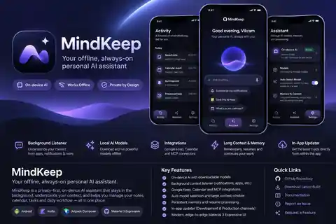

# MindKeep

<p align="center">
  
</p>

<h1 align="center">MindKeep</h1>
<p align="center"><strong>Your private, on-device AI companion.</strong></p>

<p align="center">
  Capture context, organise knowledge, manage tasks and continue unfinished work — with local-first intelligence on Android.
</p>

<p align="center">
  
</p>

<p align="center">
  
  
  
  
  
</p>

## What is MindKeep?

MindKeep is an offline-first personal assistant and second brain for Android. Its goal is to keep useful context in one place, help you act on it, and make personal AI available without sending conversations to a hosted AI service.

The app is being built around three main areas:

- **Activity** — a timeline of what MindKeep has captured or done, including saved notes, tasks, reminders and background events.
- **Assistant** — local model downloads, default model selection, automatic model selection, private conversations and persistent memory.
- **Settings** — grouped controls for integrations, permissions, updates, privacy and app preferences.

## Features

### Available in the current foundation

- Material 3 Compose app with Activity, Assistant and Settings destinations.
- Local notes, tasks and reminders with app-private persistence.
- Local reminder scheduling through WorkManager.
- Opt-in Android notification-listener service; access must be granted manually in Android settings.
- Subpage back navigation with animated horizontal transitions.
- In-app development and production update channels.
- Local conversation history and keyword-based retrieval of older turns.
- A durable WorkManager queue for assistant work that can be retried when a compatible model becomes available.

### Local AI

MindKeep is designed to run inference on-device. The current implementation uses the LiteRT-LM runtime integration and provides a model catalogue with device-memory checks.

The catalogue currently lists:

| Model | Approx. download | Intended device class |
|---|---:|---|
| Qwen 3 0.6B | 328 MB | Entry-level / lower-memory phones |
| Qwen 3 1.7B | 932 MB | Mid-range phones |
| Gemma 4 E2B | 2.34 GB | Higher-memory phones |

Model sizes are approximate and can change as upstream artifacts are updated. Actual runtime memory requirements depend on quantisation, context length, Android version, available RAM and device acceleration support. The app checks current free RAM as a basic selection signal; it is not a guarantee that a model will run on every device.

The Assistant screen supports downloading selected model files, choosing a default model and enabling automatic selection among installed models. Model inference is local; there is no cloud fallback. The exact model/runtime pairing is still being validated across devices.

### Privacy principles

1. **Local by default:** notes and assistant history are stored in app-private storage.
2. **No remote inference:** prompts are not sent to a hosted model by the local assistant runtime.
3. **Explicit permissions:** notification access is opt-in and must be enabled by the user.
4. **Network only when needed:** internet access is used for release checks and downloads that the user initiates.
5. **Replaceable AI layer:** model/runtime integration is isolated behind core AI components.

## Technology

- Kotlin
- Jetpack Compose
- Material 3
- AndroidX WorkManager
- Navigation Compose
- Google LiteRT-LM
- App-private JSON persistence (Room/DataStore migration is planned)

## Project structure

```text
app/
├── assets/                         # README artwork and source app icon
│   ├── mindkeep-icon.png
│   └── mindkeep-banner.webp
└── src/main/
    ├── assets/                     # Runtime assets, if needed
    ├── java/com/vikram/mindkeep/
    │   ├── core/ai/                 # Model catalogue, local runtime, memory and work queue
    │   ├── data/                    # Local persistence and reminder worker
    │   └── feature/                 # Activity, Assistant, Settings and updater UI
    └── res/mipmap-xxxhdpi/
        └── ic_launcher.png
```

## Build locally

1. Install Android Studio and a compatible JDK.
2. Install Android SDK Platform 36.
3. Open the repository in Android Studio.
4. Sync Gradle and run the `app` configuration on an Android 8.0+ device (API 26+).

The repository currently targets compile/target SDK 36 and uses the Gradle wrapper checked into the project.

## GitHub Actions

- **Debug APK:** builds on pushes to `main` and replaces the single `debug-latest` prerelease.
- **Release APK:** manually triggered from **Actions → Release APK → Run workflow**.

Both workflows use the configured CI signing secrets. Never commit a keystore or signing passwords.

[Download the latest debug build](https://github.com/hustlewithvikram/mindkeep/releases/tag/debug-latest) · [All releases](https://github.com/hustlewithvikram/mindkeep/releases)

## Permissions

| Permission / access | Why it is used |
|---|---|
| `INTERNET` | Check releases and download user-selected models or APK updates |
| `POST_NOTIFICATIONS` | Show local reminder notifications on Android 13+ |
| Notification access | Optional capture of notification events after explicit user opt-in |
| Install unknown apps | Android may ask for this when the user chooses to install an APK downloaded by the in-app updater |

MindKeep does not request contacts, location, camera or microphone permissions in the current foundation.

## Roadmap

- [ ] Validate supported LiteRT-LM model artifacts and backend compatibility on real devices.
- [ ] Improve memory retrieval with structured facts, summaries and context budgeting.
- [ ] Add model-specific context-window controls and model capability metadata.
- [ ] Complete notification capture controls and Activity event history.
- [ ] Implement authenticated Google Keep and Google Calendar integrations.
- [ ] Add MCP connector discovery and permission-scoped tool execution.
- [ ] Migrate local persistence to Room and add export/import.
- [ ] Add voice input and accessibility-friendly interaction.
- [ ] Expand automated UI, persistence and device compatibility tests.

## Contributing

Issues and pull requests are welcome. Please include device model, Android version, selected AI model and relevant logs when reporting a model-loading or performance issue.

## License

A repository license file has not yet been added. Until one is published, all rights remain with the repository owner; do not assume the project is open-source licensed.
